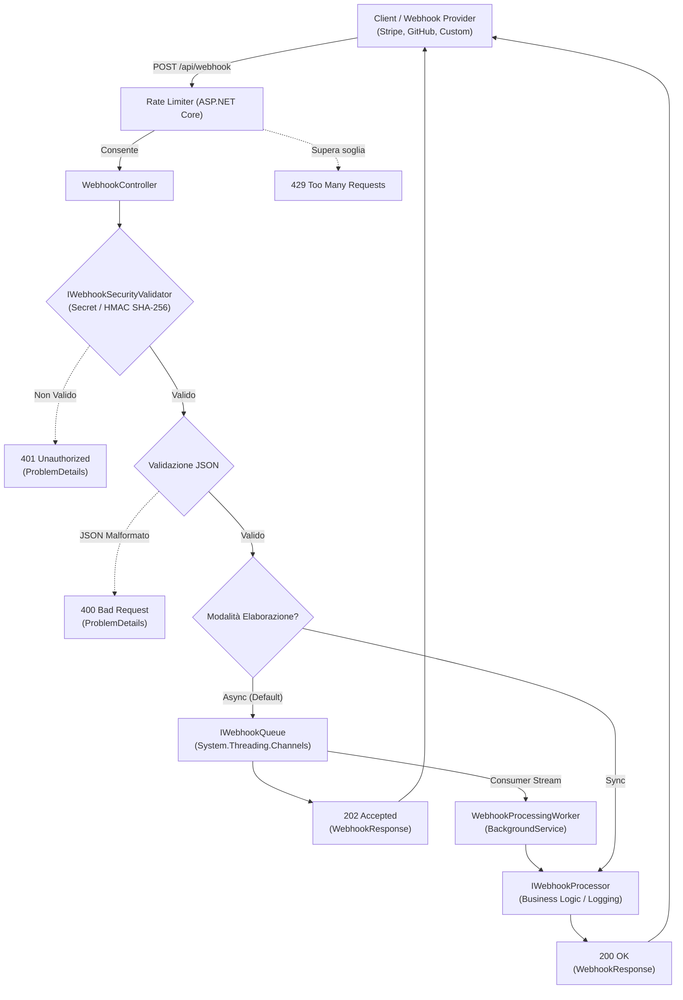

# Webhook Listener .NET 🚀

[](https://dotnet.microsoft.com/)
[](https://learn.microsoft.com/dotnet/csharp/)
[](LICENSE.txt)
[](tests/Webhook_ListenerDotNet.Tests)
[](#architettura)

Un servizio API ASP.NET Core ad alte prestazioni, sicuro e scalabile per la ricezione e l'elaborazione disaccoppiata di **webhook** (compatibile con provider come GitHub, Stripe, Shopify, Slack e sistemi personalizzati).

---

## 📋 Indice
- [Caratteristiche Principali](#-caratteristiche-principali)
- [Architettura](#-architettura)
- [Endpoint API](#-endpoint-api)
- [Sicurezza](#-sicurezza)
- [Configurazione (`appsettings.json`)](#-configurazione-appsettingsjson)
- [Guida Rapida](#-guida-rapida)
- [Esempi di Utilizzo](#-esempi-di-utilizzo)
- [Test Automatizzati](#-test-automatizzati)
- [Esecuzione con Docker](#-esecuzione-con-docker)
- [Licenza](#-licenza)

---

## ✨ Caratteristiche Principali

- **Target .NET 10**: sviluppato e ottimizzato per l'ultimo runtime e SDK .NET 10.
- **Elaborazione Asincrona Disaccoppiata (Zero Bottleneck)**:
  - Utilizza `System.Threading.Channels` (`BoundedChannel`) per memorizzare in una coda ad alta concorrenza gli eventi in arrivo.
  - Risponde immediatamente al mittente con **`202 Accepted`**, delegando la logica a un `BackgroundService` dedicato (`WebhookProcessingWorker`).
- **High-Performance JSON con `System.Text.Json`**:
  - Rimosso `Newtonsoft.Json` a favore delle API native ad altissime prestazioni e a basso impatto di memoria (`JsonDocument`, `JsonElement`).
- **Sicurezza Enterprise**:
  - Verifica opzionale tramite **Secret Token** (`X-Webhook-Secret`).
  - Verifica crittografica con **Firma HMAC-SHA256** (in stile GitHub/Stripe tramite `X-Hub-Signature-256`), con confronto in tempo costante (`CryptographicOperations.FixedTimeEquals`) per prevenire timing attacks.
  - Protezione da attacchi DoS tramite validazione della dimensione massima del payload (`MaxPayloadSizeBytes`).
- **Resilienza e Rate Limiting**:
  - Rate limiting nativo ASP.NET Core (`Microsoft.AspNetCore.RateLimiting`) per proteggere il server da flooding e picchi anomali.
- **Observability & Diagnostics**:
  - Endpoint di **Health Check** (`/health`).
  - Endpoint di stato diagnostico con metriche della coda (`/api/webhook/status`).
  - Logging contestuale e strutturato con `ILogger` (inclusione automatica di `EventId`, `EventType` e `SourceIp`).
- **Retrocompatibilità**:
  - Mantiene la compatibilità con la rotta originaria `/api/listener` oltre alle nuove `/api/webhook` e `/api/v1/webhook`.
- **OpenAPI & Swagger UI**: documentazione e collaudo interattivo integrati su `/swagger`.

---

## 🏛️ Architettura

Il flusso della richiesta è progettato per garantire la minima latenza di risposta al client del webhook, garantendo allo stesso tempo elaborazione affidabile e sicura:



---

## 📡 Endpoint API

| Metodo | Percorso | Descrizione | Risposte Principali |
| :--- | :--- | :--- | :--- |
| `POST` | `/api/webhook`<br>`/api/v1/webhook`<br>`/api/listener` | Riceve il payload del webhook in formato JSON | `202 Accepted` (Coda asincrona)<br>`200 OK` (Sincrono)<br>`400 Bad Request`<br>`401 Unauthorized`<br>`413 Payload Too Large` |
| `GET` | `/api/webhook/status` | Stato del servizio e numero di eventi pendenti in coda | `200 OK` |
| `GET` | `/health` | Health check ASP.NET Core per Kubernetes/Docker/Cloud probe | `200 OK` ("Healthy") |
| `GET` | `/swagger` | Documentazione interattiva Swagger UI (in Development) | `200 OK` |

---

## 🔒 Sicurezza

Il listener supporta due meccanismi di autenticazione configurabili indipendentemente o insieme:

1. **Pre-shared Secret Token**:
   - Inviare l'header `X-Webhook-Secret: <tuo-token>`.
2. **HMAC-SHA256 Signature**:
   - Inviare l'header `X-Hub-Signature-256: sha256=<digest_esadecimale>`.
   - Il digest viene calcolato sul corpo grezzo binario della richiesta utilizzando il segreto `HmacSecret`.

> [!NOTE]
> Per disabilitare la verifica di sicurezza durante i test locali o in ambienti di sviluppo, imposta `"EnableSecurityValidation": false` in `appsettings.json`.

---

## ⚙️ Configurazione (`appsettings.json`)

```json
{
  "Logging": {
    "LogLevel": {
      "Default": "Information",
      "Microsoft.AspNetCore": "Warning",
      "Webhook_ListenerDotNet": "Information"
    }
  },
  "AllowedHosts": "*",
  "WebhookSettings": {
    "EnableSecurityValidation": false,
    "SecretToken": "your-super-secret-token-change-in-production",
    "SecretTokenHeaderName": "X-Webhook-Secret",
    "HmacSecret": "your-hmac-sha256-signing-secret",
    "HmacHeaderName": "X-Hub-Signature-256",
    "MaxPayloadSizeBytes": 10485760,
    "QueueCapacity": 10000,
    "EnableBackgroundProcessing": true
  }
}
```

### Parametri di `WebhookSettings`
| Chiave | Tipo | Default | Descrizione |
| :--- | :--- | :--- | :--- |
| `EnableSecurityValidation` | `bool` | `false` | Se `true`, richiede token o firma HMAC valida. |
| `SecretToken` | `string` | - | Valore del token segreto pre-condiviso. |
| `SecretTokenHeaderName` | `string` | `"X-Webhook-Secret"` | Nome dell'header contenente il token. |
| `HmacSecret` | `string` | - | Chiave crittografica per calcolare la firma HMAC-SHA256. |
| `HmacHeaderName` | `string` | `"X-Hub-Signature-256"` | Header contenente la firma HMAC. |
| `MaxPayloadSizeBytes` | `long` | `10485760` (10 MB) | Limite massimo di dimensione per singola richiesta. |
| `QueueCapacity` | `int` | `10000` | Capacità massima della coda in-memory prima del backpressure. |
| `EnableBackgroundProcessing` | `bool` | `true` | Se `true` risponde con `202 Accepted` e accoda. Se `false` elabora sincrono. |

---

## 🚀 Guida Rapida

### Prerequisiti
- [.NET 10 SDK](https://dotnet.microsoft.com/download/dotnet/10.0)

### 1. Clonare ed eseguire
```bash
# Ripristina le dipendenze
dotnet restore

# Compila la soluzione
dotnet build

# Avvia l'applicazione
dotnet run --project Webhook_ListenerDotNet
```

L'API sarà disponibile all'indirizzo configurato in `Properties/launchSettings.json` (es. `https://localhost:7291` o `http://localhost:5079`).

---

## 💻 Esempi di Utilizzo

### Inviare un Webhook (curl)
```bash
curl -X POST "http://localhost:5079/api/webhook" \
  -H "Content-Type: application/json" \
  -H "X-Event-Type: order.created" \
  -d '{
    "id": "evt_98765",
    "event": "order.created",
    "timestamp": "2026-11-09T15:00:00Z",
    "data": {
      "orderId": 4201,
      "amount": 89.90,
      "currency": "EUR"
    }
  }'
```

**Risposta (HTTP 202 Accepted):**
```json
{
  "eventId": "evt_98765",
  "status": "Accepted",
  "message": "Webhook event received and enqueued for asynchronous processing.",
  "timestamp": "2026-11-09T15:00:01.1234567+00:00"
}
```

### Inviare con Token Segreto (PowerShell)
```powershell
$body = @{
    event = "user.registered"
    userId = "usr_1001"
} | ConvertTo-Json

Invoke-RestMethod -Uri "http://localhost:5079/api/webhook" `
  -Method Post `
  -ContentType "application/json" `
  -Headers @{ "X-Webhook-Secret" = "your-super-secret-token-change-in-production" } `
  -Body $body
```

### Verificare lo Stato della Coda
```bash
curl http://localhost:5079/api/webhook/status
```

---

## 🧪 Test Automatizzati

Il repository include una suite completa di test unitari e di integrazione con **xUnit** e `WebApplicationFactory`:

```bash
# Esegui tutti i test
dotnet test
```

### Copertura dei test:
- **Validazione Sicurezza**: test del secret token (valido, mancante, errato), test della firma crittografica HMAC-SHA256 (valida, mismatch, malformata).
- **Coda Asincrona**: test di enqueue/dequeue concorrente con `System.Threading.Channels`.
- **Integrazione API**:
  - Risposta `202 Accepted` su payload validi.
  - Verifica della retrocompatibilità della rotta `/api/listener`.
  - Risposta `400 Bad Request` su JSON malformato o payload vuoto.
  - Risposta `200 OK` sull'endpoint di monitoraggio `/health`.

---

## 🐳 Esecuzione con Docker

È incluso un `Dockerfile` multi-stage pronto per la produzione:

```bash
# Build dell'immagine
docker build -t webhook-listener:latest .

# Avvio del container
docker run -d -p 8080:8080 --name webhook-listener webhook-listener:latest
```

L'API sarà raggiungibile su `http://localhost:8080/api/webhook` con health check su `http://localhost:8080/health`.

---

## 📄 Licenza

Distribuito sotto licenza MIT. Per maggiori dettagli, consultare il file [LICENSE.txt](LICENSE.txt).
