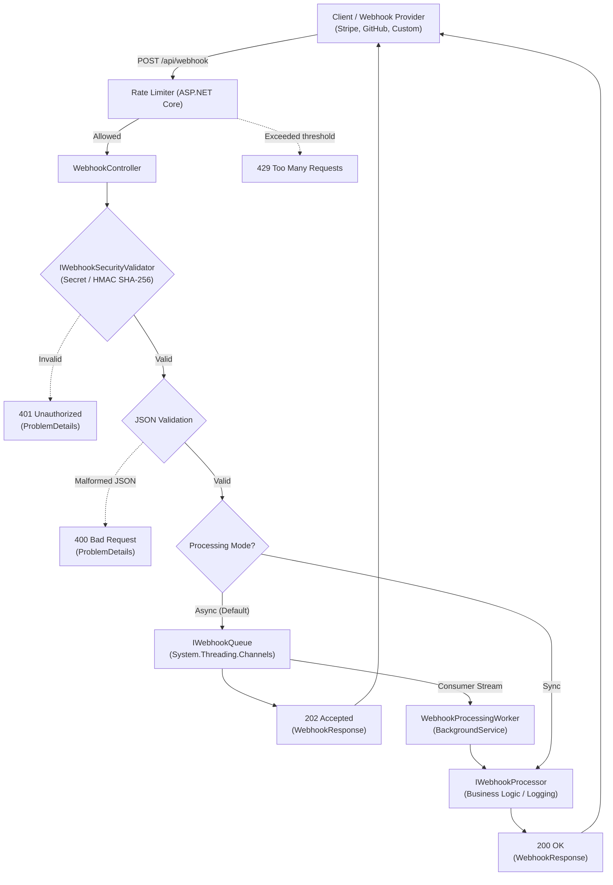

# Webhook Listener .NET 🚀

[](https://dotnet.microsoft.com/)
[](https://learn.microsoft.com/dotnet/csharp/)
[](LICENSE.txt)
[](tests/Webhook_ListenerDotNet.Tests)
[](#-architecture)

A high-performance, secure, and scalable ASP.NET Core API service designed for decoupled reception and processing of **webhooks** (compatible with providers such as GitHub, Stripe, Shopify, Slack, and custom systems).

---

## 📋 Table of Contents
- [Key Features](#-key-features)
- [Architecture](#-architecture)
- [API Endpoints](#-api-endpoints)
- [Security](#-security)
- [Configuration (`appsettings.json`)](#-configuration-appsettingsjson)
- [Quick Start](#-quick-start)
- [Usage Examples](#-usage-examples)
- [Automated Tests](#-automated-tests)
- [Running with Docker](#-running-with-docker)
- [License](#-license)

---

## ✨ Key Features

- **Target .NET 10**: Built and optimized for the latest .NET 10 runtime and C# 13 language features.
- **Decoupled Asynchronous Processing (Zero Bottlenecks)**:
  - Uses `System.Threading.Channels` (`BoundedChannel`) to buffer incoming events into a high-concurrency in-memory queue.
  - Immediately acknowledges the sender with **`202 Accepted`**, delegating heavy processing to a dedicated `BackgroundService` (`WebhookProcessingWorker`).
- **High-Performance JSON with `System.Text.Json`**:
  - Replaced legacy `Newtonsoft.Json` with high-throughput, low-allocation native APIs (`JsonDocument`, `JsonElement`).
- **Enterprise-Grade Security**:
  - Optional verification via **Pre-shared Secret Token** (`X-Webhook-Secret`).
  - Cryptographic verification via **HMAC-SHA256 Signature** (GitHub/Stripe style via `X-Hub-Signature-256`), using constant-time comparison (`CryptographicOperations.FixedTimeEquals`) to prevent timing attacks.
  - DoS protection through maximum payload size validation (`MaxPayloadSizeBytes`).
- **Resilience & Rate Limiting**:
  - Built-in ASP.NET Core rate limiting (`Microsoft.AspNetCore.RateLimiting`) to safeguard against traffic spikes and flooding.
- **Observability & Diagnostics**:
  - Health check endpoint (`/health`).
  - Diagnostic status endpoint with real-time queue metrics (`/api/webhook/status`).
  - Contextual structured logging via `ILogger` (automatically tracks `EventId`, `EventType`, and `SourceIp`).
- **Backward Compatibility**:
  - Retains full compatibility with the legacy `/api/listener` route alongside `/api/webhook` and `/api/v1/webhook`.
- **OpenAPI & Swagger UI**: Integrated interactive documentation and testing available at `/swagger`.

---

## 🏛️ Architecture

The request pipeline is designed to ensure minimal response latency for webhook callers while guaranteeing safe, reliable, and decoupled background execution:



---

## 📡 API Endpoints

| Method | Path | Description | Key Responses |
| :--- | :--- | :--- | :--- |
| `POST` | `/api/webhook`<br>`/api/v1/webhook`<br>`/api/listener` | Ingests webhook payload (JSON) | `202 Accepted` (Async queue)<br>`200 OK` (Sync mode)<br>`400 Bad Request`<br>`401 Unauthorized`<br>`413 Payload Too Large` |
| `GET` | `/api/webhook/status` | Service status and pending queue counter | `200 OK` |
| `GET` | `/health` | ASP.NET Core health check for Kubernetes/Docker/Cloud probes | `200 OK` ("Healthy") |
| `GET` | `/swagger` | Interactive Swagger UI documentation (in Development) | `200 OK` |

---

## 🔒 Security

The listener supports two authentication mechanisms that can be configured independently or combined:

1. **Pre-shared Secret Token**:
   - Send the header: `X-Webhook-Secret: <your-token>`.
2. **HMAC-SHA256 Signature**:
   - Send the header: `X-Hub-Signature-256: sha256=<hex_digest>`.
   - The digest is computed across the raw binary request body using the configured `HmacSecret`.

> [!NOTE]
> To disable security validation during local development or unit testing, set `"EnableSecurityValidation": false` in `appsettings.json`.

---

## ⚙️ Configuration (`appsettings.json`)

```json
{
  "Logging": {
    "LogLevel": {
      "Default": "Information",
      "Microsoft.AspNetCore": "Warning",
      "Webhook_ListenerDotNet": "Information"
    }
  },
  "AllowedHosts": "*",
  "WebhookSettings": {
    "EnableSecurityValidation": false,
    "SecretToken": "your-super-secret-token-change-in-production",
    "SecretTokenHeaderName": "X-Webhook-Secret",
    "HmacSecret": "your-hmac-sha256-signing-secret",
    "HmacHeaderName": "X-Hub-Signature-256",
    "MaxPayloadSizeBytes": 10485760,
    "QueueCapacity": 10000,
    "EnableBackgroundProcessing": true
  }
}
```

### `WebhookSettings` Parameters
| Key | Type | Default | Description |
| :--- | :--- | :--- | :--- |
| `EnableSecurityValidation` | `bool` | `false` | When `true`, requires a valid secret token or HMAC signature. |
| `SecretToken` | `string` | - | Pre-shared secret token value. |
| `SecretTokenHeaderName` | `string` | `"X-Webhook-Secret"` | Header name carrying the secret token. |
| `HmacSecret` | `string` | - | Cryptographic key used to verify HMAC-SHA256 signatures. |
| `HmacHeaderName` | `string` | `"X-Hub-Signature-256"` | Header name carrying the HMAC signature. |
| `MaxPayloadSizeBytes` | `long` | `10485760` (10 MB) | Maximum permitted payload size per request. |
| `QueueCapacity` | `int` | `10000` | Maximum in-memory queue capacity before applying backpressure. |
| `EnableBackgroundProcessing` | `bool` | `true` | When `true`, responds with `202 Accepted` and enqueues. When `false`, processes synchronously. |

---

## 🚀 Quick Start

### Prerequisites
- [.NET 10 SDK](https://dotnet.microsoft.com/download/dotnet/10.0)

### 1. Build and Run
```bash
# Restore dependencies
dotnet restore

# Build the solution
dotnet build

# Launch the application
dotnet run --project Webhook_ListenerDotNet
```

The API will be available at the URL configured in `Properties/launchSettings.json` (e.g., `https://localhost:7291` or `http://localhost:5079`).

---

## 💻 Usage Examples

### Sending a Webhook (curl)
```bash
curl -X POST "http://localhost:5079/api/webhook" \
  -H "Content-Type: application/json" \
  -H "X-Event-Type: order.created" \
  -d '{
    "id": "evt_98765",
    "event": "order.created",
    "timestamp": "2026-11-09T15:00:00Z",
    "data": {
      "orderId": 4201,
      "amount": 89.90,
      "currency": "EUR"
    }
  }'
```

**Response (HTTP 202 Accepted):**
```json
{
  "eventId": "evt_98765",
  "status": "Accepted",
  "message": "Webhook event received and enqueued for asynchronous processing.",
  "timestamp": "2026-11-09T15:00:01.1234567+00:00"
}
```

### Sending with a Secret Token (PowerShell)
```powershell
$body = @{
    event = "user.registered"
    userId = "usr_1001"
} | ConvertTo-Json

Invoke-RestMethod -Uri "http://localhost:5079/api/webhook" `
  -Method Post `
  -ContentType "application/json" `
  -Headers @{ "X-Webhook-Secret" = "your-super-secret-token-change-in-production" } `
  -Body $body
```

### Inspecting Queue Status
```bash
curl http://localhost:5079/api/webhook/status
```

---

## 🧪 Automated Tests

The solution includes a comprehensive unit and integration test suite built with **xUnit** and `WebApplicationFactory`:

```bash
# Execute all tests
dotnet test
```

### Test Coverage Highlights:
- **Security Validation**: Secret token validation (valid, missing, incorrect) and HMAC-SHA256 signature verification (valid, mismatch, malformed).
- **Asynchronous Queue**: High-concurrency enqueue/dequeue benchmarks using `System.Threading.Channels`.
- **API Integration**:
  - `202 Accepted` response handling on valid payloads.
  - Backward compatibility checks for the `/api/listener` route.
  - `400 Bad Request` handling on malformed JSON or empty bodies.
  - `200 OK` response checks for the `/health` probe endpoint.

---

## 🐳 Running with Docker

A multi-stage production-ready `Dockerfile` is included:

```bash
# Build the Docker image
docker build -t webhook-listener:latest .

# Run the container
docker run -d -p 8080:8080 --name webhook-listener webhook-listener:latest
```

The API will be accessible at `http://localhost:8080/api/webhook`, and the health probe at `http://localhost:8080/health`.

---

## 📄 License

Distributed under the MIT License. See [LICENSE.txt](LICENSE.txt) for more details.
